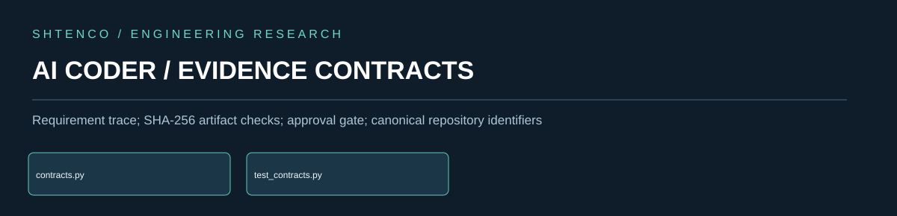
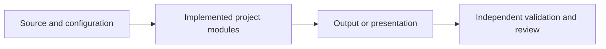
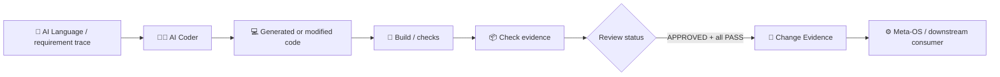
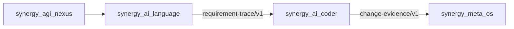

<div align="center">



**Engineering contracts, requirement traceability and change evidence**

[Overview](#verified-overview) · [Architecture](#architecture-map) · [Evidence](#evidence-boundary) · [Documentation](#original-technical-documentation)

</div>

## Verified overview

Engineering contracts, requirement traceability and change evidence. Main repository entry: `runtime/contracts.py`. This page presents a research or engineering codebase and does not imply verified production deployment.

## Architecture map



The diagram represents conceptual flow; it does not assert a live deployment.

## Evidence boundary

> Contract validation exists; successful builds and production deployments require independent checks.

| Domain | Interpretation |
|:--|:--|
| Repository files | Inspectable implementation artifacts |
| Test and CI results | Require separate current run evidence |
| Performance metrics | Require timestamped and reproducible evaluation |
| Production claims | Not established solely by documentation |

## Original technical documentation

---

# 👨‍💻 SYNERGY AI Coder — verified technical dossier

> **Статус:** 🟡 CANDIDATE / contract-runtime implemented, production execution not proven.
> **Проверено по фактическому `main`:** 29.09.2026.
> **Архитектурный родитель:** [`synergy_agi_nexus`](https://github.com/Shtenco/synergy_agi_nexus)

## 1. 🎯 Проблема

AI может генерировать код быстро, но сам факт генерации ничего не доказывает. Этот репозиторий отвечает за инженерную границу между:

```text
requirement
→ generated/edited source
→ checks
→ review state
→ artifact hash
→ change evidence
```

Главная задача — не дать системе перепутать «AI написал код» с «изменение проверено и может быть передано дальше».

## 2. 📦 Фактическое дерево `main`

```text
synergy_ai_coder/
├── README.md
├── docs/
│   └── LEGACY_DISTILLATION_V2_OWNER.md
├── runtime/
│   └── contracts.py
└── tests/
    └── test_contracts.py
```

То есть репозиторий уже **не STUB**: в нём есть реальный runtime contract layer и unit tests.

## 3. 🧠 Реализованная модель

`runtime/contracts.py` содержит два контрактных идентификатора:

```text
synergy.engineering.requirement-trace/v1
synergy.engineering.change-evidence/v1
```

и authority domain:

```text
engineering_evidence
```

Реализованы три ключевых операции:

### `consume_requirement_trace(...)`

Принимает requirement trace только если:

- `requirement_id` начинается с `REQ-`;
- целевой репозиторий входит в `affected_repositories`;
- requirement не находится в статусе `REJECTED`.

Возвращает нормализованный engineering input с requirement id, statement, validation targets, source status и target repository.

### `check_record(...)`

Формирует запись результата проверки:

- имя check обязательно;
- статус становится `PASS` или `FAIL`;
- если переданы evidence bytes, вычисляется SHA-256 и строится content-addressed evidence id.

### `change_evidence_payload(...)`

Создаёт нормализованный change-evidence object и проверяет:

- canonical repository должен начинаться с `Shtenco/`;
- commit SHA — ровно 40 hex;
- нужен минимум один `REQ-*`;
- checks обязательны;
- check status ∈ `PASS | FAIL | SKIP`;
- review status ∈ `DRAFT | REVIEWABLE | APPROVED | REJECTED`;
- `APPROVED` запрещён, если хотя бы один check не `PASS`;
- artifact bytes, если присутствуют, хэшируются SHA-256.

## 4. 🏗️ Архитектура



Ключевая идея: downstream получает не «код хороший», а структурированное evidence с commit SHA, requirement ids, checks, review status и artifact hash.

## 5. 📥 Inputs

Реализованный input boundary:

```text
requirement_id
statement
affected_repositories[]
validation_targets[]
status
```

Критически важно: requirement обязан явно таргетировать текущий репозиторий.

## 6. 📤 Outputs

`change_evidence_payload` формирует:

```text
change_id
repository
commit_sha
requirements[]
checks[]
review_status
artifact_sha256
```

Это engineering evidence, но **не deployment authorization** и не proof production correctness.

## 7. 🛡️ Authority boundaries / invariants

```text
generated source != validated source
compiled binary  != trusted binary
passing build    != passing tests
passing tests    != production correctness
AI confidence    != proof
artifact hash    != semantic correctness
APPROVED         requires all checks PASS
```

AI Coder не должен:

- самовольно деплоить;
- выдавать build за E2E;
- менять финансовую/платёжную authority;
- превращать skipped checks в pass;
- принимать requirement, который не адресован этому repo.

## 8. 🧪 Реальные тесты

`tests/test_contracts.py` сейчас проверяет минимум три негативно/позитивно важных свойства:

1. requirement trace не может быть принят, если target repository не совпадает;
2. change нельзя пометить `APPROVED`, если check = FAIL;
3. artifact hash реально создаётся и имеет 64 hex символа.

Это реальные unit tests контрактного слоя. README **не утверждает**, что они уже наблюдались в зелёном CI run.

## 9. 📚 Legacy distillation

`docs/LEGACY_DISTILLATION_V2_OWNER.md` назначает этому repository:

- `MECH-0001`;
- `MECH-0002`;

всего 4 извлечённых legacy code units.

Домен — compiler/build tooling. Promotion gate для legacy-механизмов:

- pinned compiler;
- pinned dependencies;
- clean reproducible build;
- artifact hashes;
- generated Solidity/source ≠ validated artifact.

## 10. 🔐 Threat / failure model

| Failure mode | Gate |
|---|---|
| requirement направлен не этому repo | reject |
| forged short/non-hex commit | reject |
| zero requirements | reject |
| no checks | reject |
| invalid check state | reject |
| APPROVED + FAIL/SKIP | reject |
| artifact content changed | новый SHA-256 |
| AI claims success without evidence | не формировать trusted promotion |

Следующие важные negative tests:

- duplicate requirement ids;
- empty check name in incoming raw record;
- evidence-id mismatch;
- repository spoofing;
- stale commit SHA;
- artifact hash vs checked artifact mismatch;
- review status downgrade/upgrade provenance;
- multiple reviewers / policy threshold.

## 11. 🛠️ Воспроизводимость

Минимальный локальный путь:

```bash
git clone https://github.com/Shtenco/synergy_ai_coder.git
cd synergy_ai_coder
python -m pip install pytest
pytest -q
```

Этот command path следует считать **ожидаемым**, пока конкретный run не сохранён как observed evidence.

## 12. 🗺️ Карта файлов

| Путь | Назначение |
|---|---|
| `runtime/contracts.py` | requirement/change evidence contracts |
| `tests/test_contracts.py` | unit tests contract invariants |
| `docs/LEGACY_DISTILLATION_V2_OWNER.md` | owner manifest legacy mechanisms |
| `README.md` | технический паспорт |

## 13. 🔗 Место в SYNERGY



Смежные репозитории:

- [`synergy_ai_language`](https://github.com/Shtenco/synergy_ai_language) — semantic/requirement trace;
- [`synergy_agi_nexus`](https://github.com/Shtenco/synergy_agi_nexus) — reasoning/planning;
- [`synergy_agi_autopilot`](https://github.com/Shtenco/synergy_agi_autopilot) — orchestration;
- [`synergy_meta_os`](https://github.com/Shtenco/synergy_meta_os) — downstream execution boundary.

## 14. 📊 Evidence maturity

| Layer | Status |
|---|---|
| architecture | ✅ |
| typed runtime contracts | ✅ |
| unit tests in repository | ✅ |
| artifact hashing | ✅ |
| requirement targeting guard | ✅ |
| approval all-pass guard | ✅ |
| observed CI execution | ❌ not proven here |
| cross-repo E2E evidence | ❌ not promoted |
| production deployment | ❌ |

## 15. 🚀 Roadmap

- [ ] schema files for both contracts;
- [ ] provenance signature / signer identity;
- [ ] bind check evidence to exact commit and artifact;
- [ ] deterministic build manifest;
- [ ] containerized reproduction;
- [ ] policy for required checks per repository class;
- [ ] multi-review approval;
- [ ] CI evidence artifact;
- [ ] M5 observed federation execution;
- [ ] only then consider `E2E_TESTED`.

## 16. 🛑 Что проект НЕ утверждает

- что AI-generated code автоматически корректен;
- что текущие unit tests покрывают semantic correctness;
- что build, deploy или production уже реализованы;
- что SHA-256 доказывает качество содержимого;
- что runtime contracts дают AI административную authority;
- что cross-repo E2E уже доказан.

---

[🧭 SYNERGY SYSTEM](https://github.com/Shtenco/synergy_system) · [📚 Атлас 75 репозиториев](https://github.com/Shtenco/synergy_system/blob/main/docs/SYNERGY_REPOSITORY_ATLAS.md) · [🧾 Registry](https://github.com/Shtenco/synergy_system/blob/main/registry/SYNERGY_REPOSITORIES.json)
