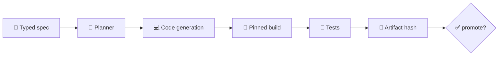

# 👨‍💻 SYNERGY AI Coder

> **AI-assisted software engineering layer of SYNERGY.**  
> Архитектурный родитель: [`synergy_agi_nexus`](https://github.com/Shtenco/synergy_agi_nexus)

## 🎯 Роль

`synergy_ai_coder` предназначен для генерации, преобразования, сборки и проверки программных артефактов, но не должен принимать факт «код сгенерирован» за факт «код корректен».



## 📚 Уже зафиксированный owner-manifest

В `docs/LEGACY_DISTILLATION_V2_OWNER.md` этому репозиторию назначены механизмы `MECH-0001` и `MECH-0002` из legacy-корпуса. Их домен — compiler/build tooling.

Promotion gate уже сформулирован жёстко:

- pinned compiler/dependencies;
- clean reproducible build from source;
- artifact hashes;
- сгенерированный Solidity-артефакт не считается проверенным только потому, что существует source text.

## 🛡️ Основной инвариант

```text
generated source != validated source
compiled binary  != trusted binary
passing build    != passing tests
AI confidence    != proof
```

## 🔗 Связи

- [`synergy_agi_nexus`](https://github.com/Shtenco/synergy_agi_nexus) — reasoning/planning;
- [`synergy_agi_autopilot`](https://github.com/Shtenco/synergy_agi_autopilot) — orchestration;
- [`synergy_ai_language`](https://github.com/Shtenco/synergy_ai_language) — semantics/contracts;
- [`synergy_meta_os`](https://github.com/Shtenco/synergy_meta_os) — execution boundary.

## 🚀 Roadmap

- [ ] typed input/output contracts;
- [ ] build manifests;
- [ ] reproducible containers;
- [ ] compiler pinning;
- [ ] test runner contracts;
- [ ] artifact hashing/provenance;
- [ ] policy gate before merge/deploy;
- [ ] negative tests against unsafe generated changes.

## 🧭 Федерация

[Атлас 75 репозиториев](https://github.com/Shtenco/synergy_system/blob/main/docs/SYNERGY_REPOSITORY_ATLAS.md)
